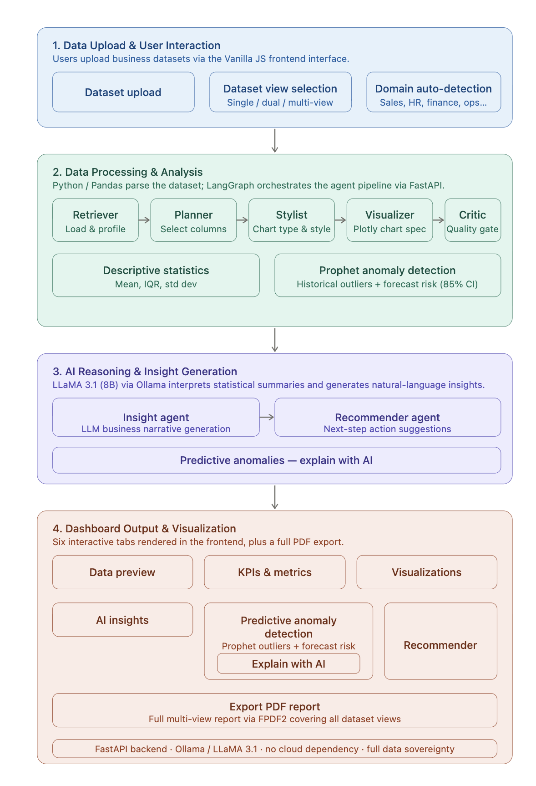

# Smart Business Analytics Dashboard

A local-first business analytics application that turns uploaded datasets into interactive visualizations, statistical summaries, anomaly analysis, and AI-generated business insights through a multi-agent workflow.

> **Nile University · Artificial Intelligence Graduation Project · 2026**
>
> Developed as a collaborative team project. This repository presents the project implementation; team members' names and individual contributions should be credited in the project documentation.

## Project Overview

The dashboard helps users explore business data without manually building every analysis step. Users upload one or more datasets, review the processed data, run an agent workflow, explore charts and KPIs, inspect potential anomalies, and receive natural-language insights and recommendations.

The application consists of a **FastAPI/Python backend** and a **vanilla JavaScript frontend**. LangGraph coordinates the analysis workflow, while a locally hosted LLaMA model is accessed through Ollama for AI-generated explanations and recommendations.

## Main Capabilities

- Upload CSV, Excel, JSON, XML, Parquet, and TXT datasets.
- Preprocess and profile uploaded data with Pandas.
- Analyze one or multiple dataset views.
- Generate interactive Plotly visualizations and business KPIs.
- Calculate descriptive statistics and identify statistical outliers.
- Run time-series forecasting and predictive anomaly analysis with Prophet.
- Generate natural-language business insights and suggested next steps using a local LLM.
- Export an analytical report as a PDF.

## System Architecture



The workflow is organized into four stages:

1. **Data upload and interaction** — users upload datasets, choose the analysis view, and begin the workflow.
2. **Data processing and analysis** — Python/Pandas prepares and profiles the data; LangGraph coordinates the agent workflow; statistical analysis and Prophet forecasting identify patterns and potential anomalies.
3. **AI reasoning and insight generation** — LLaMA 3.1, served locally through Ollama, generates business narratives, anomaly explanations, and recommendations.
4. **Dashboard output** — the frontend presents data previews, KPIs, charts, insights, anomaly analysis, recommendations, and PDF export.

### Agent Workflow

The backend includes the following agent roles:

| Agent | Responsibility |
|---|---|
| Retriever | Loads and profiles the available datasets |
| Planner | Selects relevant columns and analytical priorities |
| Stylist | Chooses chart types and visual styles |
| Visualizer | Builds visualization specifications |
| Critic | Reviews visualization quality and supports refinement |
| Insight | Produces natural-language business analysis |
| Recommender | Suggests possible next actions |

## Technology Stack

- **Language:** Python, JavaScript, HTML, CSS
- **Backend/API:** FastAPI, Uvicorn
- **Data processing:** Pandas, NumPy
- **Agent orchestration:** LangGraph
- **Local LLM runtime:** Ollama (default model: LLaMA 3.1 8B)
- **Machine learning and analysis:** Scikit-learn, Prophet
- **Visualization and reporting:** Plotly, Kaleido, fpdf2

## Repository Structure

```text
smart-business-analytics-dashboard/
├── .github/
│   └── workflows/
│       └── source-checks.yml
├── assets/
│   ├── architecture.png
│   └── demo.mp4
├── backend/
│   ├── __init__.py
│   ├── agents_core.py
│   ├── config.py
│   ├── main.py
│   └── requirements.txt
├── frontend/
│   ├── index.html
│   ├── css/
│   │   └── style.css
│   └── js/
│       └── app.js
├── tests/
│   └── test_app.py
├── launch.py
├── requirements.txt
└── README.md
```

## Run Locally

### Prerequisites

- Python 3.10 or newer.
- [Ollama](https://ollama.com/) installed locally.
- Sufficient memory to run the selected Ollama model. A smaller model can be configured if needed.

### 1. Clone the repository

```bash
git clone https://github.com/faridasalahh/smart-business-analytics-dashboard.git
cd smart-business-analytics-dashboard
```

### 2. Create and activate a virtual environment

macOS / Linux:

```bash
python3 -m venv .venv
source .venv/bin/activate
```

Windows PowerShell:

```powershell
python -m venv .venv
.venv\Scripts\Activate.ps1
```

### 3. Install Python dependencies

```bash
python -m pip install --upgrade pip
pip install -r requirements.txt
```

### 4. Start Ollama and download the model

Make sure the Ollama application/service is running, then run:

```bash
ollama pull llama3.1:8b
```

The backend defaults to the Ollama service at `http://127.0.0.1:11434` and the model `llama3.1:8b`. The model can be changed with the `LLM_MODEL` environment variable. The Ollama host can be changed with `OLLAMA_HOST`.

### 5. Launch the application

```bash
python launch.py
```

The launcher starts the FastAPI server on the local loopback interface (127.0.0.1) and opens the dashboard in your browser. The launcher intentionally ignores a `HOST` override so the demo is not accidentally exposed to your local network.

- **Dashboard:** http://localhost:8000
- **API documentation:** http://localhost:8000/docs
- **Health check:** http://localhost:8000/api/health

Press `Ctrl+C` in the terminal to stop the application.

### Run the automated checks

The repository includes backend smoke and security regression tests. After installing the application dependencies, install the test tools and run:

```bash
python -m pip install pytest httpx==0.27.2
python -m pytest -q
```

GitHub Actions runs Python/JavaScript syntax checks and the backend test suite on pushes and pull requests.

## Data and Privacy

The project is designed to use a locally running Ollama model for LLM inference. This avoids sending prompts to a hosted LLM API as part of the default local setup.

Uploaded datasets and generated artifacts are handled by the running application. Uploads are limited to 25 MB per file. Runtime files are excluded from Git by `.gitignore`. **Do not upload confidential business data, personal information, API keys, local environment files, or private datasets to this repository.** Review your local configuration and sample files before publishing or sharing the project.

**Security boundary:** the application is intended for local demonstrations. The launcher binds to `127.0.0.1` by default and the API does not implement user authentication or production-grade session management. Do not expose it to a public network through a custom Uvicorn command, reverse proxy, or other deployment setup without first implementing authentication, authorization, robust session management, and deployment hardening.

## Project Context and Credits

**Smart Dashboard Generation for Business Analytics Using LLMs** was developed as a collaborative senior project at **Nile University**, School of Information Technology and Computer Science, under **CSCI495 / AIS495 Senior Project II**.

**Project team**
- Nosaiba Mekawy
- Shahd Nagah
- Aly Sakr
- Al Basel Waleed
- Farida Salah
- Mohamed Waleed

**Supervised by**
- Dr. Ensaf Hussein
- Eng. Mohamed Ibrahim

The project was submitted in partial fulfilment of the requirements for the bachelor's degree in Information Technology and Computer Science, with the Computer Science and Artificial Intelligence program.

## Limitations

- AI-generated insights depend on the local Ollama service and the selected model being available.
- Forecasting quality depends on the presence and quality of a usable time column and sufficient historical observations.
- Some input formats may require optional parsing engines in the Python environment.
- This repository contains the application source code; datasets and model weights are not included.
- The current application should be treated as an academic project/demo, not deployed as a production service without additional security, access-control, and operational hardening. The local-only protections are defense-in-depth for a single-user demo, not authentication or a security boundary for multi-user use.

## License

This repository does not currently include an open-source license. The code is therefore not granted permissions for public reuse, modification, or redistribution.
